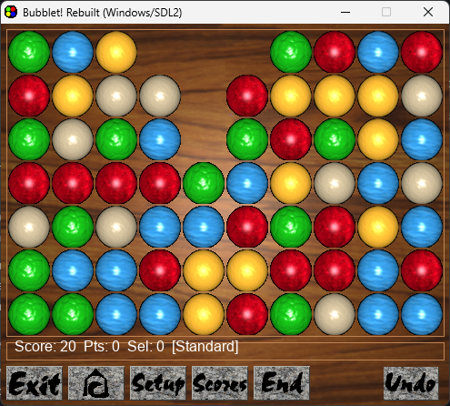

# Bubblet! Rebuilt

A rebuild of the classic Windows shareware puzzle game **Bubblet!**, ported to SDL2 so it runs on modern **Windows, macOS and Linux**.

## Download

Get the latest version from the **[Releases page](https://github.com/mnkhprre/Bubblet-rebuilt/releases/latest)**:

| Platform | File | How to install |
|---|---|---|
| Windows 10/11 (64-bit) | `Bubblet-<version>-Setup.exe` | Run the installer. No admin rights needed. |
| macOS (Apple Silicon and Intel) | `Bubblet-<version>-macOS-universal.dmg` | Open the DMG and drag **Bubblet** into **Applications**. |
| Debian / Ubuntu (amd64) | `bubblet_<version>_amd64.deb` | `sudo apt install ./bubblet_<version>_amd64.deb`, then start it from the app menu or run `bubblet`. |

The builds are not signed by Microsoft or Apple, so the first launch shows a warning:

- **Windows SmartScreen:** click **More info → Run anyway**.
- **macOS:** open the app once, then go to **System Settings → Privacy & Security** and click **Open Anyway**.

## How to play

Click a group of two or more connected bubbles of the same colour to highlight it, then click it again to pop it. Bubbles above fall down to fill the gap. The bigger the group, the more points you get. The game ends when no group of two or more is left.

There are four game styles, chosen in **Setup**: **Standard**, **Shifter**, **Continuous** and **MegaShift**.

- In **Standard** and **Shifter**, the fewer bubbles you leave at the end, the bigger your bonus (500 points for clearing the board).
- In **Continuous** and **MegaShift**, empty columns are refilled with new bubbles, so the game keeps going longer. There is no end-of-game bonus.

**Undo** takes back your last move.

## Building from source

The game is plain C with SDL2, SDL2_mixer, SDL2_ttf and libcurl. All build files live in the [`Bubblet!`](Bubblet!) folder.

| Platform | Command (run inside `Bubblet!`) |
|---|---|
| Windows (MSYS2 UCRT64) | `make -f Makefile.windows installer` |
| macOS (Homebrew) | `bash packaging/build_macos.sh <version>` |
| Debian / Ubuntu | `bash packaging/build_deb.sh <version>` |

Each script lists the packages it needs at the top. When a release is published on GitHub, the [release workflow](.github/workflows/release-packages.yml) builds the macOS and Debian packages and attaches them automatically.

See [CHANGELOG.md](CHANGELOG.md) for what changed in each version.

## Credits

- **Bubblet** was originally created by Frank Fejes for the PalmPilot.
- The Windows version of **Bubblet!** was made by Dirk Klein (House of Bytes); its original source code is at [dklein42/Bubblet](https://github.com/dklein42/Bubblet).
- This project rebuilds that Windows version for modern systems.
